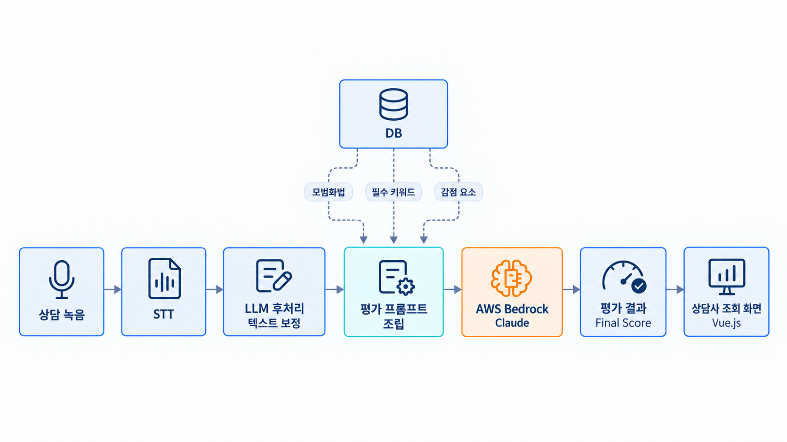
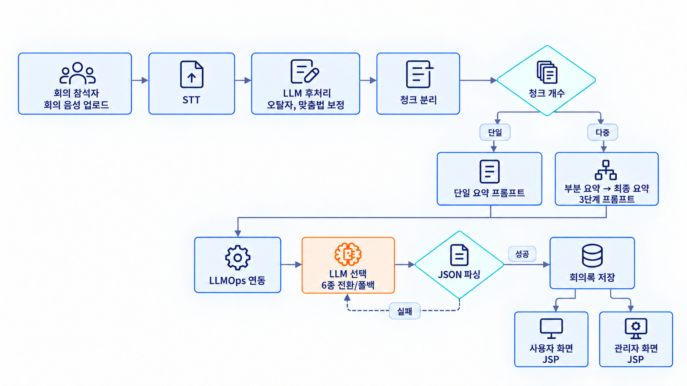
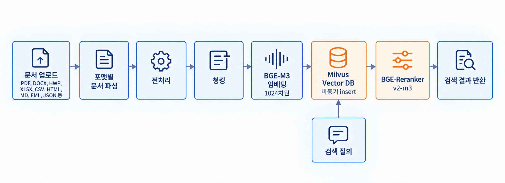
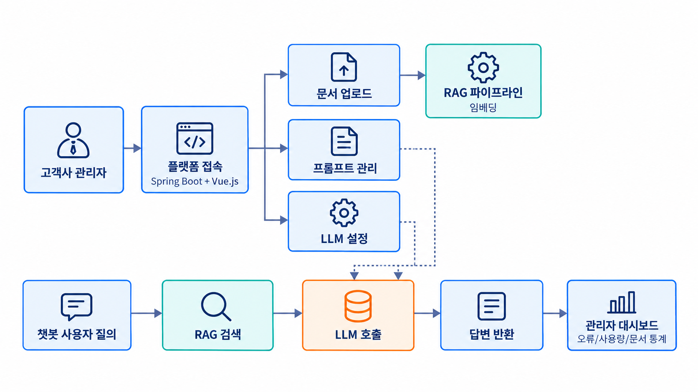
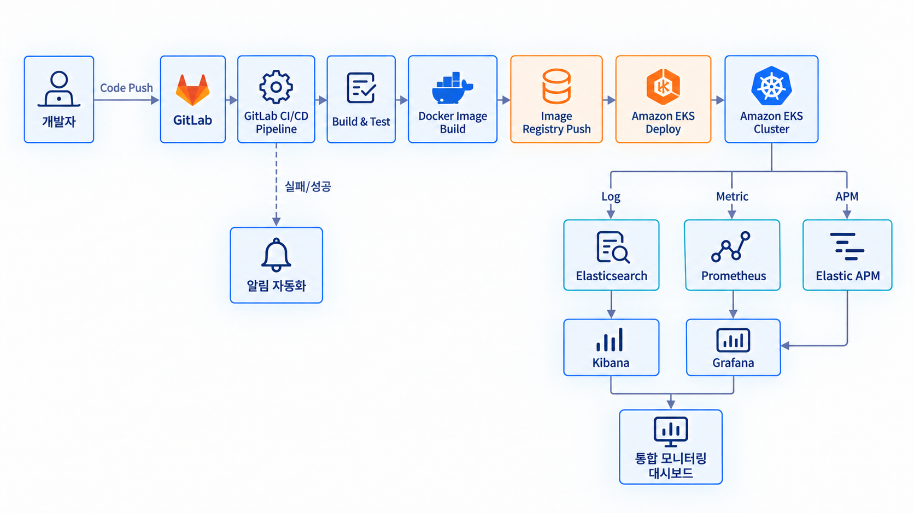
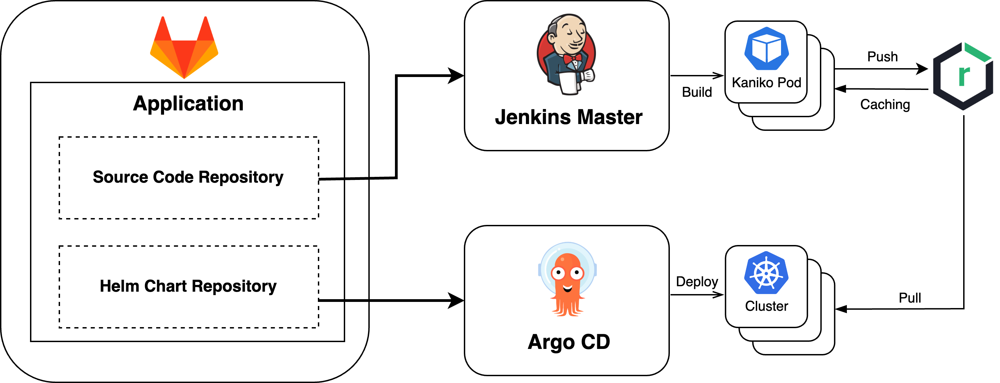
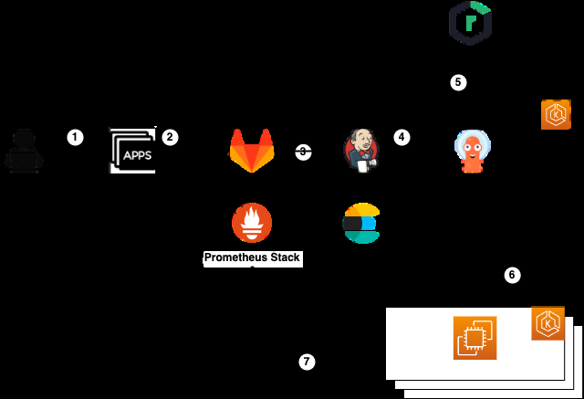
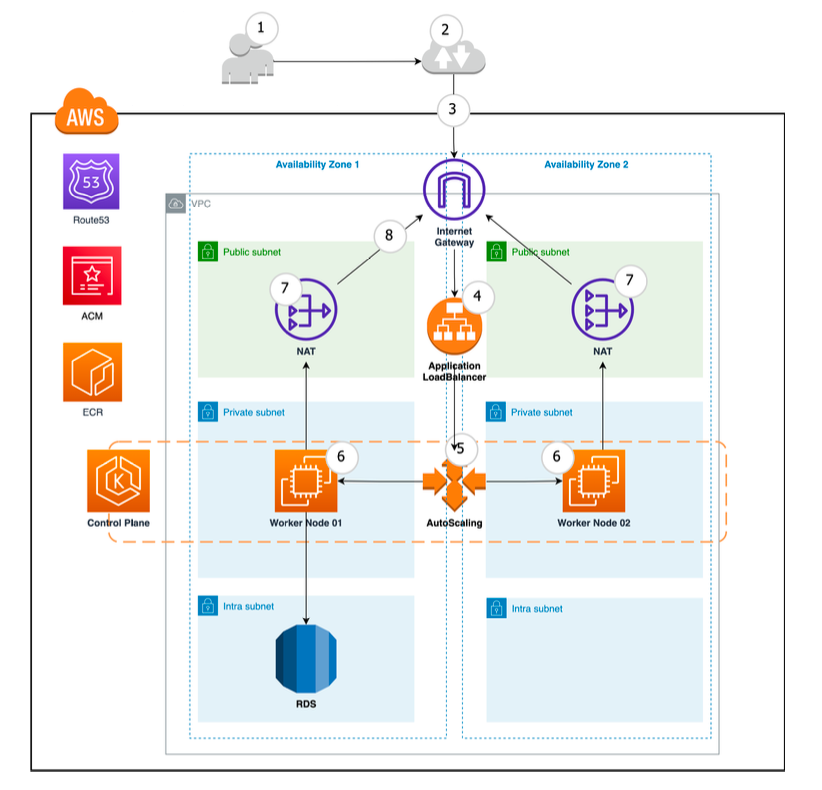

# 박재범 포트폴리오

> 💡 늘 배우고자 하는 자세로 인생을 살아가는 박재범입니다.

  

---

## 기본 인적 사항

- **박재범 (JaeBum Park)**
- Email: kyontoki0209@gmail.com
- 생년월일: 1996년 02월 09일

## 학력

- **숭실대학교 학사 졸업**
- 2017.03 ~ 2023.08
- IT대학 전자정보공학부 IT 융합전공

---

## 경력

### 페르소나 AI

- **재직 기간**: 2024.10.02 ~ 재직중
- **소속**: AI 사업부 솔루션 개발팀
- **직위**: 사원
- **수행 업무 및 프로젝트**
  - LLM, RAG 기반 AI 챗봇 솔루션 개발
  - 공공기관 회의록 자동화 시스템 개발
  - LLM 기반 상담사 튜터 솔루션 개발
  - RAG 솔루션 개발

### 스패로우

- **재직 기간**: 2024.04.01 ~ 2024.06.30
- **소속**: 스패로우 SP개발1팀
- **직위**: 인턴
- **수행 업무 및 프로젝트**
  - 클라우드 인프라 환경 내 모니터링 시스템 구축
  - 빌드 및 배포 자동화를 위한 CI/CD Pipeline 구축
  - 빌드 및 배포 실패 측정을 위한 자동화 알림 구축

---

## 기술 스택

| 분야 | 태그 |
| --- | --- |
| Programming Languages | Java, Python |
| Frameworks | Spring Boot, Vue.js, FastAPI, JSP |
| Database | MySQL, Oracle, Milvus |
| AI/LLM | LLM, RAG, BGE-M3, LLMOps |
| OS | Mac, Windows, Linux (Ubuntu/CentOS) |
| Virtualization | Docker, Kubernetes |
| CI/CD Tools | ArgoCD, Jenkins, GitLab CI/CD |
| Monitoring Tools | Elasticsearch, Grafana, Kibana, Prometheus, Elastic APM |
| Cloud Provisioner | AWS |
| etc | Git, GitLab |

---

# Projects

## 페르소나 AI

### LLM 기반 상담사 튜터 솔루션

> STT로 자동 수집되는 상담 텍스트를 LLM으로 요약, 평가하여, 상담사에게는 개인 상담 피드백을, 관리자에게는 팀 통합 상담 품질 리포트를 제공하는 상담 평가 자동화 솔루션

| 항목 | 내용 |
| --- | --- |
| 작업 기간 | 2026.06 ~ 2026.09 |
| 서비스 대상 | - 상담사: 본인의 상담 요약과 모범화법 대비 평가 피드백 조회 - 관리자: 팀 통합 상담 품질 리포트 조회 |
| 프로젝트 목적 | 수동으로 청취, 평가하던 상담 품질 관리를 LLM으로 자동화하여 상담사별 평가 편차를 제거하고, STT로 유입되는 대량 상담을 실시간에 가깝게 평가할 수 있는 체계를 구축 |
| 주요업무 및 상세역할 | - AWS Bedrock 기반 LLM 호출 인터페이스 설계, 구현 - 모범화법, 필수 키워드, 감점 요소 기반 상담 평가 로직 설계, 구현 - STT 결과 후처리 및 프롬프트 최적화 - Vue.js 기반 상담 결과 조회 화면 개발 |
| 사용 기술 스택 | Java, Spring Boot, AWS Bedrock (Claude), Vue.js, MySQL |
| 성과 및 결과 | - 상담 평가 처리 시간 약 13% 단축 - LLM이 도메인 기준(모범화법, 필수 키워드, 감점 요소)에 맞춰 일관된 품질의 평가를 제공하도록 프롬프트 최적화 완료 - 실서비스로 납품, 고객사 현업에서 활용 중 |

**서비스 흐름**

---

### LLM 기반 공공기관 회의록 자동화 시스템

> 회의 참석자가 회의 음성을 업로드하면 STT, LLM 연동으로 회의록을 자동 생성, 요약해주고, 관리자는 LLM, 프롬프트, 배치, 접속 로그를 통합 관리할 수 있는 공공기관용 회의록 자동화 시스템

| 항목 | 내용 |
| --- | --- |
| 작업 기간 | 2025.10 ~ 2026.06 |
| 서비스 대상 | - 사용자(회의 참석자): 회의 등록, 회의록 조회, 수정, 재요약 이용 - 관리자: LLM 모델, 프롬프트, 배치, 로그, 사용 내역 통합 관리 |
| 프로젝트 목적 | 공공기관의 수기 회의록 작성 업무를 자동화하여 담당자 부담을 줄이고, 다양한 LLM(6종)을 전환, 폴백 가능한 확장 구조로 구축하며, LLMOps 플랫폼과 연동해 프롬프트, 모델 관리를 안정화하는 것을 목표로 진행 |
| 주요업무 및 상세역할 | - Java 기반 LLM 호출 인터페이스 설계, 개발 및 다중 LLM(6종) 전환, 폴백 구조 구축 - STT 결과 오탈자, 맞춤법 후보정 및 청크 분리 요약 로직 구현 - 회의 요약, 파일 관리 배치 스케줄링 구현 - LLMOps 서비스 연동으로 LLM, 프롬프트 관리 체계 구축 - 사용자 화면 및 관리자 화면 개발 (JSP) |
| 사용 기술 스택 | Java, Spring Boot, JSP, MyBatis, LLM, LLMOps, MySQL |
| 성과 및 결과 | - 수작업 중심의 회의록 작성 과정을 자동화하여 공무원 업무 부담 감소 - 6종 LLM을 자유롭게 전환, 폴백 가능한 확장 구조 확보 - 재사용 가능한 표준 LLM 호출 구조를 공통 모듈로 구현하여 후속 AI 프로젝트에 활용 가능한 자산 확보 - 실서비스로 납품, 고객사 현업에서 활용 중 |

**서비스 흐름**

---

### RAG 솔루션

> 다양한 포맷의 고객사 문서를 파싱, 전처리, 청킹, 임베딩하여 Vector DB에 저장하는 RAG 데이터 파이프라인. FastAPI 기반 API 서비스로 제공되며, 다수 고객사에 도입된 RAG 솔루션

| 항목 | 내용 |
| --- | --- |
| 작업 기간 | 2025.06 ~ 2025.08 |
| 서비스 대상 | 사내 임직원 대상 문서 기반 질의응답을 제공하려는 다수 고객사 |
| 프로젝트 목적 | 고객사의 비정형, 반정형 문서를 의미 기반 검색이 가능한 지식으로 전환하여, LLM이 외부 지식을 검색해 답변에 반영할 수 있는 RAG 서비스 기반을 회사 솔루션 형태로 마련 |
| 주요업무 및 상세역할 | - 다양한 포맷 문서 파싱, 전처리, 청킹, 임베딩 파이프라인 설계, 구현 - BGE-M3 임베딩 + Milvus 벡터 DB 기반 검색 인프라 구축 - 대용량 문서 자동 임베딩 배치 스크립트 개발 |
| 사용 기술 스택 | Python, FastAPI, Milvus, BGE-M3 |
| 성과 및 결과 | - 신규 문서를 일관된 절차로 안정적으로 적재할 수 있는 표준 파이프라인 구축 - 다수 고객사 POC 성공적 완료 및 실서비스 확산 - 문서를 검색 가능한 지식으로 전환하는 RAG 파이프라인의 설계, 구현 역량 확보 - 회사 공통 RAG 솔루션의 핵심 컴포넌트로 자산화 |

**서비스 흐름**

---

### LLM, RAG 기반 AI 챗봇 솔루션

> 기업 고객사가 자사 문서, 데이터를 기반으로 LLM 챗봇을 직접 구축, 운영할 수 있도록 지원하는 상용 AI 챗봇 플랫폼. 관리자는 프롬프트, 문서, LLM을 관리하고, 오류, 사용량을 모니터링할 수 있는 SaaS형 솔루션

| 항목 | 내용 |
| --- | --- |
| 작업 기간 | 2025.01 ~ 2025.06 |
| 서비스 대상 | 자사 데이터 기반 AI 챗봇을 운영하려는 기업 고객사의 관리자, 운영자 |
| 프로젝트 목적 | LLM과 RAG를 결합한 상용 챗봇 플랫폼을 SaaS 형태로 제공하여, 기업 고객사가 자체 데이터로 챗봇을 손쉽게 구축, 운영할 수 있는 생태계 마련 |
| 주요업무 및 상세역할 | - Spring Boot, Vue.js 기반 LLM 챗봇 플랫폼 풀스택 개발 - 오류 모니터링, 문서 통계, 프롬프트 관리 기능 구현 - 관리자 대시보드 및 사용량 통계 시각화 개발 |
| 사용 기술 스택 | Java, Spring Boot, Vue.js, LLM, RAG, MySQL |
| 성과 및 결과 | - 상용 AI 솔루션 전반의 개발 경험 확보 - Front-end와 Back-end를 아우르는 풀스택 개발 역량 확보 - 후속 AI 프로젝트(회의록, 상담 튜터 등)에 공통 자산, 경험으로 이어짐 |

**서비스 흐름**

---

## 스패로우 (인턴)

### Amazon EKS 통합 모니터링 대시보드 및 CI/CD 파이프라인 구축

> 클라우드 환경 내 개발 속도와 운영 안정성을 동시에 끌어올리기 위해 통합 모니터링과 배포 자동화 체계를 구축

| 항목 | 내용 |
| --- | --- |
| 작업 기간 | 2024.04 ~ 2024.06 |
| 서비스 대상 | 사내 개발팀: 통합 모니터링 대시보드로 서비스 상태 확인, CI/CD 파이프라인으로 빌드, 배포 자동화 이용 |
| 프로젝트 목적 | 이상 징후를 사전에 파악할 수 있는 통합 모니터링과 수동 배포 부담을 줄이는 CI/CD 자동화 체계 구축 |
| 주요업무 및 상세역할 | - Amazon EKS 환경에 Log, Metric, APM을 통합한 모니터링 대시보드 구축 - GitLab CI/CD 파이프라인 설계 및 구축 - 빌드부터 배포까지 전 과정 자동화 - 빌드 및 배포 실패 알림 자동화 구축 |
| 사용 기술 스택 | Kubernetes, Amazon EKS, GitLab CI/CD, Elasticsearch, Kibana, Prometheus, Grafana, Elastic APM |
| 성과 및 결과 | - 수동 배포 부담 감소 및 배포 소요 시간 단축 - 애플리케이션 이상과 장애를 빠르게 파악할 수 있는 운영 체계 마련 - 운영 안정성까지 고려하는 개발 관점 확보 |

**서비스 흐름**

---

## 공모전

### Cloud, K8S를 이용한 개발환경 자동 구축 시스템

> 개발자에게 사내 개발환경 제공 및 개발한 서비스에 대해 배포/운영을 테스트할 수 있게 해주는 자동화 시스템 제작

| 항목 | 내용 |
| --- | --- |
| 작업 기간 | 2023.03.10 ~ 2023.05.03 |
| 인력 구성 | Back-end 1명, Front-end 1명, Resource monitoring system 구축 1명, Log monitoring system 구축 1명, **AWS 인프라 구축 및 CI/CD pipeline 구축 1명 (담당 Part)** |
| 프로젝트 목적 | DevOps 관점에서 CI/CD Pipeline, Monitoring 등의 기능을 제공하여 개발/운영의 간극을 줄여줄 수 있도록 개발 서비스 배포 및 운영 테스트를 손쉽게 실행해주는 Service 제작을 목표로 Team Project로 진행 |
| 주요업무 및 상세역할 | - Jenkins, ArgoCD, GitLab을 활용한 CI/CD pipeline 구축 - AWS Service를 이용한 Cloud infra 환경 구축 - EKS Cluster 내 Opensource deploy |
| 사용 기술 스택 | AWS, Jenkins, ArgoCD, GitLab, EKS (Kubernetes), Docker, Nexus3, Helm |
| 성과 및 결과 | - 다수의 팀원들과 협업하며 Team Project 진행 시 팀원 개인별 모듈화의 중요성과 효과적인 협업 방식을 깨달음 - Public Cloud 환경에서 Project를 진행하며 Cloud Provisioner AWS 환경과 AWS 내 서비스 이해도 상승 - CI/CD pipeline 구축 전략에 대해 고찰하며 프로젝트를 진행하여 Application Build 속도, Build 환경 보안 향상 등의 결과를 도출 |
| 참고 자료 | - YouTube: https://www.youtube.com/watch?v=e50cfM8ad88 - GitHub: https://github.com/JaeBumPark/5KA_project_CICD |

### CI/CD Pipeline 구축 전략

- **GitOps 방식으로 CI/CD pipeline 구축**: 애플리케이션의 배포와 운영에 관련된 모든 요소를 코드화하여 확장성, 안정성, 보안성을 보장하는 GitOps-based CI/CD pipeline 구축. Application Source code Repo와 Deployment code Repo로 애플리케이션/배포 manifest code를 나누어 Git 형상 관리
- **Jenkins Master/Agent 분리**: Build 환경의 보안, Pipeline 병렬 실행 시 안정성 등의 이유로 Docker image build와 push가 일어나는 환경을 Central cluster에 Pod 형태로 구축하여 Jenkins Master와 Agent 실행 환경을 격리
- **Docker build tool로 Kaniko 도입**: Build 속도 최적화를 위해 Agent Pod으로 Kaniko를 띄워 Build 진행. Image Build 시 Nexus Cache Repository를 참조하여 Build 속도를 향상시키도록 구현

### Service Architecture

- 신입 개발자가 Application의 code를 변경 후 GitLab Application Source code repository에 push
- Central Cluster의 Jenkins가 변경된 코드를 기반으로 Application Build 및 Dockerfile을 이용해 Docker Image Build
- Docker Image를 Nexus repository에 push, Docker Image tag 기반으로 GitLab의 배포 환경 구성 저장소의 Deploy manifest file 변경
- Central Cluster의 ArgoCD가 GitLab의 배포 환경 구성 저장소의 manifest를 참조해 새로 Push된 Docker Image 기반으로 Application을 K8s resource 형태로 deploy 준비
- ArgoCD가 신입 개발자가 소속된 부서에게 제공된 Cluster 내에 Application을 배포
- 리소스 Monitoring tools는 Central Cluster와 부서별 Cluster에 배포돼 있는 상태

### Infra Architecture

- 보안상의 이유로 Public, Private, Intra Subnet을 구성
- EKS Node group은 Private subnet에 배치 후 Public Subnet의 Bastion server로만 접속할 수 있도록 설정
- RDS는 Intra Subnet에 배치 후 Back-end와 통신하도록 설정
- Autoscaling을 통해 EKS의 Node 갯수를 관리
- 개발한 서비스와 Opensource들은 Kubernetes ingress와 ALB, SSL, Route 53을 연동시켜 URL로 접근할 수 있도록 설정
- Back-end, Front-end, Open-source 구동 시 사용되는 Docker image들은 ECR에 팀원들만 사용할 수 있도록 권한을 제어하여 관리

---

## Prize

- 🏆 **카카오 클라우드 엔지니어 양성 과정 최우수 프로젝트상** (카카오, 한국전파진흥협회, 2023.5)

---

## My Channel

- GitHub: https://github.com/JaeBumPark
- YouTube: https://www.youtube.com/channel/UCwQNy5__86_5Hb-_seHn2Tw
